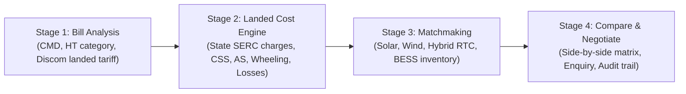

# COMPETITOR_BENCHMARK.md — Competitor Intelligence & Strategic Positioning

## 1. Executive Summary

A thorough review and live verification of the Indian energy procurement landscape reveals that the market is currently split into disconnected silos:
- **Offline Brokerage & Listing Boards** (PowerConnect): Manual classifieds without transaction intelligence or economics.
- **Renewable PPA Facilitators** (Solicue, Opten Power): Focused on matchmaking and RFP tendering, but lack deep bill-level analytics and broader multi-technology assets (BESS, Pumped Hydro, EPC, Tenders).
- **Consultancy-Led Advisors** (Aran Tecnovation): Rely on manual email exchanges of HT utility bills without self-service software tooling.
- **Think-Tank Modeling Tools** (CEEW GFC Open Access Calculator): Excellent regulatory mathematical models, but completely disconnected from real-world supplier inventory and procurement workflows.
- **Energy Trading & Exchange Portals** (Clickpower, IEX, PXIL, HPX): Regulated market settlement and automated dispatch tools for licensed market participants, rather than factory procurement decision engines.

**Electricity Bazaar's Strategic Advantage**:
> **"India's Power Procurement Intelligence Marketplace — from electricity bill to the best-fit procurement opportunity."**
> We bridge the gap between *analytical landed-cost modeling* (like CEEW) and *actionable supplier discovery* (like Solicue/Opten Power), unified under a single, transparent B2B workflow.

---

## 2. Verified Competitor Landscape Matrix

| Competitor | Platform URL | Primary Archetype | Target Audience | Key Strengths | Critical Gaps & Limitations |
| :--- | :--- | :--- | :--- | :--- | :--- |
| **Solicue** | [solicue.com](https://www.solicue.com/) | Open Access Solar Marketplace | C&I consumers, Off-site solar developers | Clean UI, standardized PPA assistance, matchmaking focus | Solar-only (lacks Wind, RTC, BESS, Pumped Hydro), no self-service bill diagnostics, heavy reliance on offline deal executives. |
| **Opten Power** | [optenpower.com](https://www.optenpower.com/) | Clean Energy & Asset Marketplace | C&I buyers, IPPs, EPCs, Investors | Project discovery, RFP tendering automation, asset trading data room | Geared towards large-scale corporate PPAs and developer asset sales; lacks accessible bill-level landed cost tools for factory plant engineers. |
| **Aran Tecnovation** | [arantec.in](https://arantec.in/buy-power/) | Advisory & Facilitation Firm | HT consumers in Tamil Nadu & South India | High domain credibility, deep knowledge of local SERC regulations | Not a software platform; requires manual emailing of 3 monthly HT bills; manual consulting delivery. |
| **PowerConnect** | [repowerconnect.in](https://repowerconnect.in/browse) | Sector Directory & Classifieds | IPPs, land aggregators, consultants, consumers | Broad category coverage (land, approvals, EPC, power) | Unstructured classifieds; no landed-cost calculation, no matching algorithm, no technical performance verification. |
| **Clickpower** | [clickpower.in](https://www.clickpower.in/) | Energy Decision & Portfolio Engine | Utilities, large IPPs, trading desks | Direct exchange integration (DAM/RTM/GDAM), REC trading, algorithmic dispatch | Too complex for standard C&I buyers deciding between third-party open access and group captive; focused on wholesale market dispatch. |
| **CEEW GFC Calculator** | [ceew.in](https://www.ceew.in/gfc/tools_and_dashboards/oa/calculator) | Regulatory Economics Calculator | Policy makers, developers, C&I analysts | Deep state-wise tariff modeling, waiver scenario analysis, multi-voltage levels | Disconnected from live supplier capacity; users calculate savings but cannot act on or procure power. |
| **Regulated Exchanges (IEX, PXIL, HPX)** | [iexindia.com](https://www.iexindia.com/) | Regulated Power Exchanges | Grid-connected utilities, trading licensees, large OA | Real-time liquidity, central counterparty clearing, national benchmark pricing | Strict regulatory barriers to entry, requires licensed member intermediaries, focused on short-term/day-ahead electricity trading rather than multi-year corporate PPAs. |

---

## 3. The 4-Stage Buyer Journey: Where Electricity Bazaar Wins

### Stage 1: Electricity Bill Decomposition
- Industrial consumers start by inputting their current electricity bill parameters:
  - State and Distribution Licensee (e.g., Telangana TSSPDCL).
  - Consumer Category (e.g., HT-I Industry General, 11 kV / 33 kV / 132 kV).
  - Contracted Maximum Demand (CMD) in kVA/MW and monthly consumption (kWh).
  - Current utility bill components (Fixed demand charges, energy charges, TOD surcharge, electricity duty).
  - Derived baseline landed cost: e.g., **₹8.85 / kWh**.

### Stage 2: State-Specific Regulatory Landed-Cost Modeling
- The system automatically retrieves verified state-specific open access charges based on latest SERC tariff orders:
  - **Third-Party Open Access**:
    - Energy Tariff (e.g., ₹3.60/kWh)
    - Transmission & Wheeling Charges (e.g., ₹0.85/kWh)
    - Cross-Subsidy Surcharge (CSS) (e.g., ₹1.98/kWh for TSSPDCL HT-I 11kV)
    - Additional Surcharge (AS) (e.g., ₹0.00 – ₹0.50/kWh dynamic)
    - STU & CTU Transmission Losses (e.g., 3.8% STU)
    - Total Landed Cost: **₹6.98 / kWh** (Net saving: **₹1.87 / kWh** or **21.1%**).
  - **Group Captive Model**:
    - Mandates 26% equity ownership and 51% proportional consumption.
    - **CSS = ₹0.00 / kWh** (Statutory waiver under Electricity Act Sec 42(2)).
    - **AS = ₹0.00 / kWh** (Waiver under TSERC/CERC regulations).
    - Total Landed Cost: **₹4.60 / kWh** (Net saving: **₹4.25 / kWh** or **48.0%**).

### Stage 3: Instant Supplier Matchmaking
- Rather than an academic output, the consumer's evaluated scenario immediately searches Electricity Bazaar's verified supplier inventory:
  - Filters by available capacity meeting the consumer's load profile.
  - Matches technology (Solar for daytime peaks, Wind/RTC for continuous 24/7 industrial loads, BESS for peak shaving).
  - Validates inter-connection feasibility (e.g., Telangana STU grid connection).

### Stage 4: Transparent Comparison & Secure Negotiation
- Side-by-side comparison of up to 5 supplier proposals across:
  - Tariff & escalation terms.
  - Commercial structure (PPA vs Group Captive SPV).
  - Commissioning timeline & interconnection status.
  - Verification badges (audited documents, land possession, connectivity approvals).
- In-platform enquiry initiation with buyer confidentiality protection.

---

## 4. Initial Geographic Focus: Telangana Pilot Benchmark

To ensure extreme regulatory precision and market traction, Electricity Bazaar establishes **Telangana (TSSPDCL & TSNPDCL)** as its flagship pilot state:
1. **High C&I Concentration**: Major industrial clusters in Hyderabad, Medak, Rangareddy, and Warangal (Pharma, IT, Textiles, Heavy Manufacturing).
2. **High Retail Tariffs**: HT-I industrial tariffs range from ₹7.50 to ₹9.20/kWh, creating an attractive financial spread for open access savings.
3. **Active Regulatory Activity**: TSERC actively issues bi-annual additional surcharge orders and annual retail tariff orders, making dynamic regulatory intelligence an invaluable tool.
4. **Subsequent Expansion Sequence**:
   - Phase 1 Pilot: **Telangana**
   - Phase 1 Expansion: **Gujarat, Maharashtra, Rajasthan, Tamil Nadu, Karnataka**
   - Phase 2: Pan-India coverage across all 28 states and union territories.
