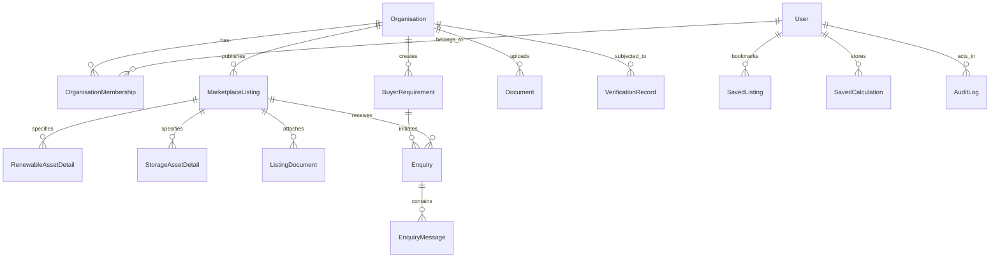

# DATABASE_DESIGN.md — Relational Schema & Data Modeling

## 1. Relational Architecture & Principles

Electricity Bazaar leverages **PostgreSQL** as its single source of truth, managed via **Prisma ORM**. The data model is designed around strict third normal form (3NF) principles with domain-specific extensions, enforcing:

1. **Multi-Tenant Referential Integrity**: Every business entity (requirement, listing, document, enquiry) is bound to an `Organisation` with foreign key constraints and `ON DELETE RESTRICT` (or cascading where appropriate).
2. **Immutable Auditability**: State transitions, verification decisions, and moderation actions create timestamped records in an `AuditLog` table.
3. **Compound & Filter Indices**: High-performance composite B-tree indices on frequent filter vectors: `(status, state, category, capacityMw)` to ensure sub-50ms query latency on marketplace search.
4. **Data Isolation**: Separation of public listing data from confidential buyer consumption metrics and supplier commercial documents.

---

## 2. Entity Relationship Diagram (Conceptual)



---

## 3. Core Database Enums

```prisma
enum Role {
  BUYER_USER
  BUYER_ADMIN
  SELLER_USER
  SELLER_ADMIN
  SERVICE_PROVIDER
  VERIFICATION_OFFICER
  PLATFORM_ADMIN
}

enum OrgType {
  BUYER_CI
  RE_DEVELOPER
  CONVENTIONAL_GENERATOR
  CAPTIVE_PRODUCER
  ELECTRICITY_TRADER
  STORAGE_OPERATOR
  SOLAR_EPC
  EQUIPMENT_SUPPLIER
  ADVISORY_CONSULTANT
}

enum VerificationStatus {
  UNVERIFIED
  SUBMITTED_FOR_VERIFICATION
  DOCUMENTS_REVIEWED
  VERIFIED_FOR_STATED_SCOPE
  VERIFICATION_EXPIRED
  REJECTED
}

enum ListingCategory {
  ELECTRICITY_SUPPLY
  SOLAR_POWER
  WIND_POWER
  HYBRID_RENEWABLE
  RTC_FIRM_POWER
  CAPTIVE_POWER
  GROUP_CAPTIVE
  OPEN_ACCESS_SHORT_TERM
  BATTERY_STORAGE
  PUMPED_HYDRO_STORAGE
  SOLAR_EPC
  ELECTRICAL_EQUIPMENT
  POWER_CONSULTANCY
}

enum CommercialModel {
  THIRD_PARTY_OPEN_ACCESS
  GROUP_CAPTIVE
  CAPTIVE
  ROOFTOP_PPA_OPEX
  CAPEX_SALE
  ENERGY_STORAGE_SERVICE_AGREEMENT
  EPC_TURNKEY
  CONSULTING_RETAINER
}

enum ProjectStatus {
  OPERATIONAL
  UNDER_CONSTRUCTION
  READY_TO_BUILD
  ADVANCED_DEVELOPMENT
  FEASIBILITY_STAGE
}

enum InterconnectionType {
  CTU_INTER_STATE
  STU_INTRA_STATE
  BEHIND_THE_METER
}

enum ListingStatus {
  DRAFT
  UNDER_REVIEW
  PUBLISHED
  SUSPENDED
  EXPIRED
  ARCHIVED
}

enum RequirementStatus {
  DRAFT
  ACTIVE
  MATCHED
  FULFILLED
  CLOSED
}

enum EnquiryStatus {
  SUBMITTED
  UNDER_REVIEW
  SHARED_WITH_SUPPLIER
  RESPONSE_RECEIVED
  NEGOTIATION
  CLOSED
  WITHDRAWN
}

enum TenderType {
  POWER_PROCUREMENT
  RENEWABLE_ENERGY
  BESS_STORAGE
  SOLAR_EPC
  TRANSMISSION_EVACUATION
  EQUIPMENT_SUPPLY
  ADVISORY_CONSULTANCY
}
```

---

## 4. Prisma Schema Specification (`schema.prisma`)

```prisma
datasource db {
  provider = "postgresql"
  url      = env("DATABASE_URL")
}

generator client {
  provider = "prisma-client-js"
}

model User {
  id               String                   @id @default(uuid())
  email            String                   @unique
  passwordHash     String
  fullName         String
  phone            String?
  isEmailVerified  Boolean                  @default(false)
  emailVerifyToken String?
  resetToken       String?
  resetTokenExpiry DateTime?
  createdAt        DateTime                 @default(now())
  updatedAt        DateTime                 @updatedAt

  memberships      OrganisationMembership[]
  savedListings    SavedListing[]
  savedCalculations SavedCalculation[]
  auditLogs        AuditLog[]

  @@index([email])
}

model Organisation {
  id                   String                 @id @default(uuid())
  legalName            String
  tradeName            String?
  registrationNumber   String?                // CIN / LLPIN / GSTIN
  orgType              OrgType
  verificationStatus   VerificationStatus     @default(UNVERIFIED)
  verificationNotes    String?
  verifiedAt           DateTime?
  registeredState      String
  headquartersAddress  String?
  websiteUrl           String?
  isDemoData           Boolean                @default(false)
  createdAt            DateTime               @default(now())
  updatedAt            DateTime               @updatedAt

  memberships          OrganisationMembership[]
  requirements         BuyerRequirement[]
  listings             MarketplaceListing[]
  serviceListings      ServiceListing[]
  documents            Document[]
  verificationRecords  VerificationRecord[]
  enquiriesSent        Enquiry[]              @relation("BuyerEnquiries")
  enquiriesReceived    Enquiry[]              @relation("SellerEnquiries")
  auditLogs            AuditLog[]

  @@index([orgType, verificationStatus])
  @@index([legalName])
}

model OrganisationMembership {
  id             String       @id @default(uuid())
  userId         String
  organisationId String
  role           Role         @default(BUYER_USER)
  isPrimaryOrg   Boolean      @default(true)
  createdAt      DateTime     @default(now())

  user           User         @relation(fields: [userId], references: [id], onDelete: Cascade)
  organisation   Organisation @relation(fields: [organisationId], references: [id], onDelete: Cascade)

  @@unique([userId, organisationId])
  @@index([organisationId, role])
}

model BuyerRequirement {
  id                       String            @id @default(uuid())
  requirementCode          String            @unique // e.g., REQ-2026-XXXX
  organisationId           String
  title                    String
  industryType             String
  state                    String
  discomName               String            // Electricity Distribution Licensee
  numberOfFacilities       Int               @default(1)
  contractDemandKva        Float
  sanctionedLoadKw         Float
  monthlyConsumptionKwh    Float
  currentSupplyCostPerKwh  Float?            // Landed cost in Rs/kWh
  targetRenewablePercent   Float             @default(50.0)
  preferredTechnology      String?           // Solar, Wind, Hybrid, RTC
  commercialModel          CommercialModel   @default(THIRD_PARTY_OPEN_ACCESS)
  requiredStartDate        DateTime
  contractTenureYears      Int
  openAccessPreference     String?           // Captive, Group Captive, Third Party
  additionalNotes          String?
  status                   RequirementStatus @default(DRAFT)
  isConsentGivenToShare    Boolean           @default(false)
  createdAt                DateTime          @default(now())
  updatedAt                DateTime          @updatedAt

  organisation             Organisation      @relation(fields: [organisationId], references: [id], onDelete: Cascade)
  enquiries                Enquiry[]

  @@index([organisationId, status])
  @@index([state, targetRenewablePercent])
}

model MarketplaceListing {
  id                   String               @id @default(uuid())
  listingCode          String               @unique // e.g., LST-2026-XXXX
  organisationId       String
  title                String
  slug                 String               @unique
  category             ListingCategory
  commercialModel      CommercialModel
  state                String
  projectLocation      String
  totalCapacityMw      Float
  availableCapacityMw  Float
  indicativePricePerKwh Float?               // In Rs/kWh (null if purely custom)
  priceBasisConditions String?              // e.g. "Ex-busbar at 33kV STU, escalates 2% pa"
  contractDurationYears Int?
  expectedAvailabilityDate DateTime
  interconnectionType  InterconnectionType  @default(STU_INTRA_STATE)
  substationDetails    String?
  projectStatus        ProjectStatus        @default(OPERATIONAL)
  regulatoryApprovals  String?              // e.g. "In-principle STU approval obtained"
  isFeatured           Boolean              @default(false)
  status               ListingStatus        @default(DRAFT)
  isDemoData           Boolean              @default(false)
  viewCount            Int                  @default(0)
  createdAt            DateTime             @default(now())
  updatedAt            DateTime             @updatedAt

  organisation         Organisation         @relation(fields: [organisationId], references: [id], onDelete: Cascade)
  renewableDetails     RenewableAssetDetail?
  storageDetails       StorageAssetDetail?
  documents            ListingDocument[]
  enquiries            Enquiry[]
  savedByUsers         SavedListing[]

  @@index([status, category, state])
  @@index([availableCapacityMw, indicativePricePerKwh])
}

model RenewableAssetDetail {
  id                   String              @id @default(uuid())
  listingId            String              @unique
  technology           String              // Solar Mono-PERC, Wind Class-III, Hybrid, RTC
  dcAcRatio            Float?
  cuFactorPercent      Float?              // Capacity Utilisation Factor (CUF %)
  expectedAnnualGenMu  Float?              // Million Units (MUs)
  captiveStructureInfo String?             // e.g. "Compliant with 26% equity / 51% consumption"
  bankingTerms         String?

  listing              MarketplaceListing  @relation(fields: [listingId], references: [id], onDelete: Cascade)
}

model StorageAssetDetail {
  id                     String             @id @default(uuid())
  listingId              String             @unique
  storageType            String             // BESS Li-ion LFP, Pumped Hydro Storage (PSP)
  powerCapacityMw        Float              // Instantaneous power (MW)
  energyCapacityMwh      Float              // Total stored energy capacity (MWh)
  durationHours          Float              // C-rate equivalent discharge duration
  roundTripEfficiencyPct Float?             // RTE %
  chargingEnergySource   String?            // Dedicated Solar, Off-peak Grid
  commercialPricingModel String?            // Fixed Capacity charge Rs/MW/month or Rs/kWh throughput

  listing                MarketplaceListing @relation(fields: [listingId], references: [id], onDelete: Cascade)
}

model ServiceListing {
  id                   String               @id @default(uuid())
  serviceCode          String               @unique // SRV-2026-XXXX
  organisationId       String
  title                String
  category             String               // Open Access Advisory, Solar EPC, Energy Audit, etc.
  description          String
  geographicalCoverage String[]             // Array of States or Pan-India
  qualifications       String?
  pricingModel         String?
  status               ListingStatus        @default(PUBLISHED)
  isDemoData           Boolean              @default(false)
  createdAt            DateTime             @default(now())
  updatedAt            DateTime             @updatedAt

  organisation         Organisation         @relation(fields: [organisationId], references: [id], onDelete: Cascade)

  @@index([category, status])
}

model TenderOpportunity {
  id                 String     @id @default(uuid())
  tenderRefNo        String     @unique
  issuingAuthority   String     // SECI, NTPC, State Discom, SJVN
  tenderType         TenderType
  title              String
  state              String
  capacityMw         Float?
  estimatedValueInr  Float?     // In INR Lakhs or Crores (null if not published)
  submissionDeadline DateTime   // UTC timestamp, displayed in Asia/Kolkata
  sourceUrl          String
  documentAttachment String?
  isVerifiedSource   Boolean    @default(true)
  isDemoData         Boolean    @default(false)
  createdAt          DateTime   @default(now())
  updatedAt          DateTime   @updatedAt

  @@index([tenderType, submissionDeadline])
}

model Document {
  id             String            @id @default(uuid())
  organisationId String
  title          String
  documentType   String            // CONNECTIVITY_APPROVAL, AUDITED_BALANCE_SHEET, PPA_TRACK_RECORD
  fileKey        String            // Private storage key
  mimeType       String
  fileSize       Int
  isVerified     Boolean           @default(false)
  verifiedAt     DateTime?
  verifiedBy     String?
  createdAt      DateTime          @default(now())

  organisation   Organisation      @relation(fields: [organisationId], references: [id], onDelete: Cascade)
  listingLinks   ListingDocument[]

  @@index([organisationId, documentType])
}

model ListingDocument {
  id         String             @id @default(uuid())
  listingId  String
  documentId String

  listing    MarketplaceListing @relation(fields: [listingId], references: [id], onDelete: Cascade)
  document   Document           @relation(fields: [documentId], references: [id], onDelete: Cascade)

  @@unique([listingId, documentId])
}

model VerificationRecord {
  id             String             @id @default(uuid())
  organisationId String
  reviewerUserId String
  previousStatus VerificationStatus
  newStatus      VerificationStatus
  scopeNotes     String             // Evidence reviewed, legal scope certified
  createdAt      DateTime           @default(now())

  organisation   Organisation       @relation(fields: [organisationId], references: [id], onDelete: Cascade)

  @@index([organisationId, createdAt])
}

model Enquiry {
  id                  String             @id @default(uuid())
  enquiryCode         String             @unique // ENQ-2026-XXXX
  listingId           String
  buyerOrganisationId String
  requirementId       String?
  proposedCapacityMw  Float?
  message             String
  status              EnquiryStatus      @default(SUBMITTED)
  buyerConsentGranted Boolean            @default(true)
  createdAt           DateTime           @default(now())
  updatedAt           DateTime           @updatedAt

  listing             MarketplaceListing @relation(fields: [listingId], references: [id], onDelete: Cascade)
  buyerOrganisation   Organisation       @relation("BuyerEnquiries", fields: [buyerOrganisationId], references: [id], onDelete: Cascade)
  requirement         BuyerRequirement?  @relation(fields: [requirementId], references: [id], onDelete: SetNull)
  messages            EnquiryMessage[]

  @@index([buyerOrganisationId, status])
  @@index([listingId, status])
}

model EnquiryMessage {
  id             String       @id @default(uuid())
  enquiryId      String
  senderUserId   String
  senderOrgId    String
  messageText    String
  createdAt      DateTime     @default(now())

  enquiry        Enquiry      @relation(fields: [enquiryId], references: [id], onDelete: Cascade)

  @@index([enquiryId, createdAt])
}

model SavedListing {
  id         String             @id @default(uuid())
  userId     String
  listingId  String
  createdAt  DateTime           @default(now())

  user       User               @relation(fields: [userId], references: [id], onDelete: Cascade)
  listing    MarketplaceListing @relation(fields: [listingId], references: [id], onDelete: Cascade)

  @@unique([userId, listingId])
}

model SavedCalculation {
  id             String       @id @default(uuid())
  userId         String
  scenarioName   String
  state          String
  annualKwh      Float
  existingTariff Float
  proposedTariff Float
  calculatedData Json         // Complete breakdown of surcharges, losses and annual savings
  createdAt      DateTime     @default(now())
  updatedAt      DateTime     @updatedAt

  user           User         @relation(fields: [userId], references: [id], onDelete: Cascade)

  @@index([userId, createdAt])
}

model AuditLog {
  id             String        @id @default(uuid())
  userId         String?
  organisationId String?
  action         String        // LISTING_SUBMITTED, VERIFICATION_DECISION, ENQUIRY_STATUS_CHANGE
  entityName     String        // MarketplaceListing, Organisation, etc.
  entityId       String
  metadata       Json?
  ipAddress      String?
  userAgent      String?
  createdAt      DateTime      @default(now())

  user           User?         @relation(fields: [userId], references: [id], onDelete: SetNull)
  organisation   Organisation? @relation(fields: [organisationId], references: [id], onDelete: SetNull)

  @@index([entityName, entityId])
  @@index([createdAt])
}
```
